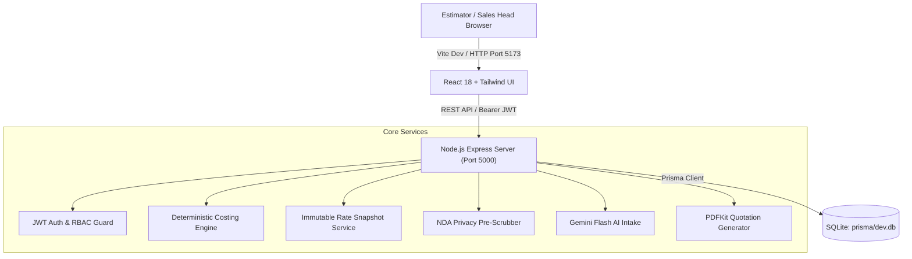
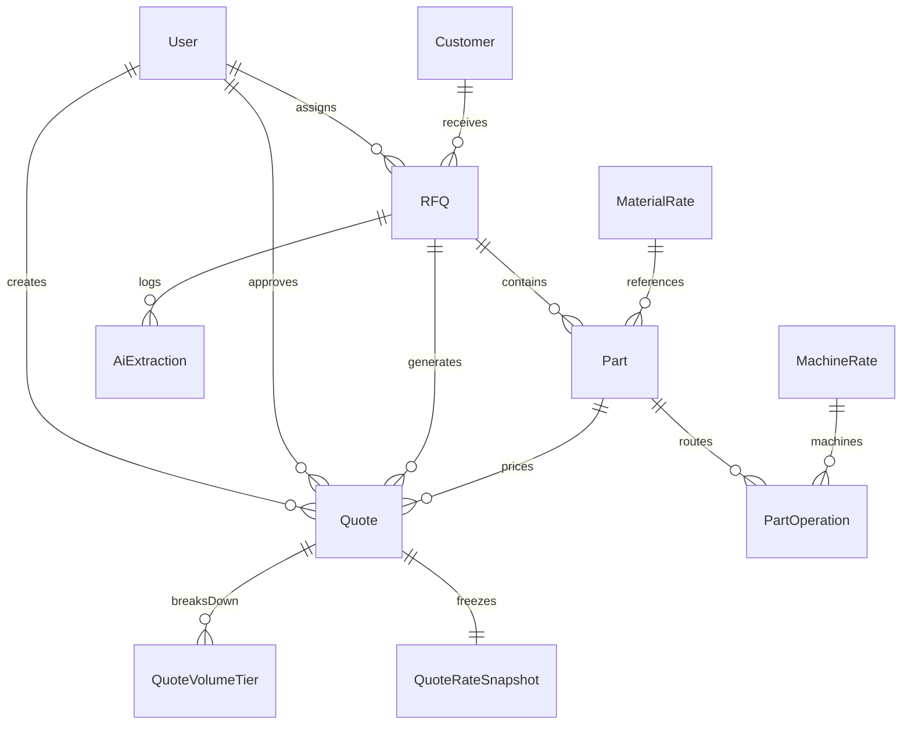

# Technical Design Document (TDD)
## Isocode RFQ-to-Quote Costing Web Application

---

## 1. System Architecture & Tech Stack

### 1.1 Architectural Rationale (8 GB RAM Developer Laptop Optimization)
The system is intentionally engineered with a zero-daemon runtime to ensure frictionless, sub-second execution on a machine with 8 GB RAM:
- **Backend**: Node.js + Express + TypeScript. Memory consumption under 80 MB.
- **ORM & Storage**: Prisma ORM with SQLite (`dev.db`). Avoids running background PostgreSQL or Docker engine processes which consume 500 MB – 1.2 GB of continuous background RAM on Windows. Prisma's database abstraction guarantees that shifting from SQLite to PostgreSQL in production requires changing a single line in `schema.prisma` (`provider = "postgresql"`).
- **Frontend**: React 18 + TypeScript + Vite + Tailwind CSS. Production bundle size is only 249 kB (67 kB gzipped).
- **PDF Generation**: PDFKit deterministic server-side rendering with streaming buffer response.
- **AI Processing**: Google Gemini Flash (Free Tier) with pre-transmission PII redactor and localized heuristic regex fallback.

---

## 2. Database Schema Design & Relationships

The relational data model is normalized to Third Normal Form (3NF) with immutable historical snapshotting:

### Table Specifications:
1. **User**: Authentication, role enforcement (`ESTIMATOR`, `SALES_HEAD`, `ADMIN`), department.
2. **Customer**: Tier-1 OEM details, sample location industrial address, GSTIN number.
3. **RFQ**: RFQ numbering (`RFQ-DEMO-xxx`), customer relation, due date tracking, status lifecycle (`ESTIMATING`, `PENDING_APPROVAL`, `SENT`, `WON`, `LOST` with loss reason).
4. **Part**: Part number, descriptive name, drawing reference & revision, gross weight (kg), net weight (kg), annual volume.
5. **RateMaster_Material**: Material grade, category, rate/kg (₹), scrap recovery rate (₹), density, `effectiveFrom`, `effectiveTo`, `isActive`.
6. **RateMaster_Machine**: Machine code, machine description, hourly rate (₹/hr), `effectiveFrom`, `effectiveTo`, `isActive`.
7. **RateMaster_Labour**: Skill grade, hourly rate (₹/hr), `effectiveFrom`, `effectiveTo`.
8. **PartOperation**: Sequence, operation name, machine relation, setup time (min), cycle time (min), labour rate.
9. **Quote**: Commercial quote header, overhead %, packing, freight, margin %, separate 18% GST, approval threshold flag, approval status, rejection reason.
10. **QuoteVolumeTier**: Itemized breakdown per volume tier: gross material, scrap credit, net material, amortized setup & machining cost, labour, direct cost, overheads, unit price ex-GST, 18% GST amount, final unit price incl. GST, total annual contract value.
11. **QuoteRateSnapshot**: JSON-serialized snapshot of exact material, machine, and labour rates frozen at calculation time.
12. **HistoricalQuote**: 1,400+ indexed past quotes for similarity search and routing reuse.
13. **AuditLog**: Comprehensive log of quotes created, approved, rejected, and rate master changes.

---

## 3. Mathematical Costing Engine Formulation

All cost mathematics follows deterministic formulas:

$$\text{Gross Material Cost} = \text{Gross Weight (kg)} \times \text{Material Rate (₹/kg)}$$
$$\text{Scrap Weight} = \max(0, \text{Gross Weight} - \text{Net Weight})$$
$$\text{Scrap Recovery Credit} = \text{Scrap Weight} \times \text{Scrap Recovery Rate (₹/kg)}$$
$$\text{Net Material Cost} = \text{Gross Material Cost} - \text{Scrap Recovery Credit}$$

For each operation $i$ amortized across batch volume $V$:
$$\text{Amortized Setup Time}_i = \frac{\text{Setup Time (min)}}{V}$$
$$\text{Total Operation Time}_i = \text{Amortized Setup Time}_i + \text{Cycle Time (min)}$$
$$\text{Machining Cost}_i = \left(\frac{\text{Total Operation Time}_i}{60}\right) \times \text{Machine Hourly Rate (₹/hr)}$$
$$\text{Labour Cost}_i = \left(\frac{\text{Total Operation Time}_i}{60}\right) \times \text{Labour Hourly Rate (₹/hr)}$$

Total Direct Cost:
$$\text{Direct Cost} = \text{Net Material Cost} + \sum \text{Machining Cost}_i + \sum \text{Labour Cost}_i$$
$$\text{Overhead Cost} = \text{Direct Cost} \times \left(\frac{\text{Overhead \%}}{100}\right)$$
$$\text{Base Manufacturing Cost} = \text{Direct Cost} + \text{Overhead Cost} + \text{Packing} + \text{Freight}$$

Commercial Pricing & Taxes:
$$\text{Unit Selling Price (ex-GST)} = \frac{\text{Base Manufacturing Cost}}{1 - (\text{Margin \%} / 100)}$$
$$\text{GST Amount (18\%)} = \text{Unit Selling Price (ex-GST)} \times 0.18$$
$$\text{Final Quoted Price (incl. GST)} = \text{Unit Selling Price (ex-GST)} + \text{GST Amount}$$
$$\text{Annual Contract Value} = \text{Unit Selling Price (ex-GST)} \times \text{Annual Volume}$$

$$\text{Approval Rule}: \quad \text{Requires Sales Head Approval} \iff \text{Annual Contract Value} > ₹25,00,000$$

---

## 4. AI RFQ Intake & Customer NDA Privacy Architecture

### 4.1 NDA Compliance & Data Scrubbing
Customer drawings and RFQs are under strict NDA agreements. Before any text is dispatched to Google Gemini:
1. **PII Masking**: Customer emails and phone numbers are redacted via regular expression filters into `[REDACTED_EMAIL]` and `[REDACTED_PHONE]`.
2. **Confidentiality Redaction**: Legal clauses such as `STRICTLY CONFIDENTIAL` or `NON-DISCLOSURE AGREEMENT` are stripped.
3. **Engineering Parameter Focus**: Only engineering descriptions, material grades, dimensions, weights, and quantities are processed.

### 4.2 Provenance Tagging & Human-in-the-Loop
For every extracted field, the system outputs:
- The extracted scalar value (e.g., `grossWeightKg: 0.61`).
- The verbatim snippet from the source input text where it was detected.
- A confidence score between 0.0 and 1.0.
- An interactive estimator acceptance toggle before any data is populated into the costing calculator.

### 4.3 Deterministic Heuristic Fallback
If the user does not possess an external API key or is running completely offline, the system seamlessly triggers its built-in regex and heuristic parsing engine.

---

## 5. UI/UX Design Decisions

The user interface follows manufacturing ERP design standards:
- **Calm, High-Density Layout**: High data density without visual clutter, utilizing slate, cool grey, and subtle sky blue accents.
- **Tabular Alignment**: Financial and engineering numbers are set in monospace font (`JetBrains Mono`) with right alignment for clear decimal comparison.
- **Multi-Volume Matrix Comparison**: The Costing screen presents side-by-side volume tiers so estimators immediately see the cost curve benefits of higher production volumes.
- **1-Click Demo Role Switcher**: A header toggle allows evaluators to swap instantly between the Estimator role and the Sales Head role without manual re-login.

---

## 6. Assumptions & Limitations

1. **Assumptions**:
   - Standard Indian automotive GST rate is 18%.
   - Setup time for machining operations is amortized linearly over the specified batch/production volume.
   - Scrap value credit assumes standard turnings and boring chips recovery rates at sample location recycling yards.
2. **Limitations**:
   - CAD 3D model geometry analysis is out of scope as specified in the assignment.
   - Live ERP synchronization with SAP or Tally is simulated through database seeding and Excel import.

---

## 7. Future Enhancements

- Automatic nesting and bar cut-off material yield optimization.
- Multi-currency quotation support (USD/EUR) for export orders with real-time forex rate tracking.
- Automated email delivery via SMTP or SendGrid for formal quotation dispatch.
- Optical Character Recognition (OCR) pipeline for scanned physical drawing blueprints.
